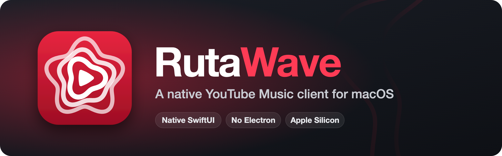
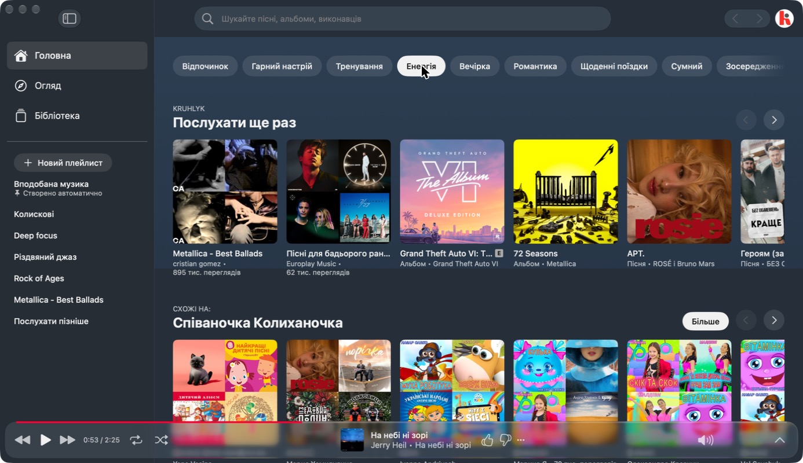
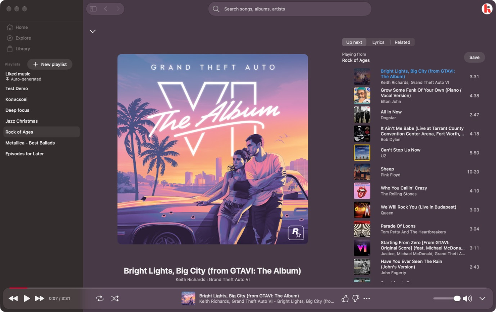
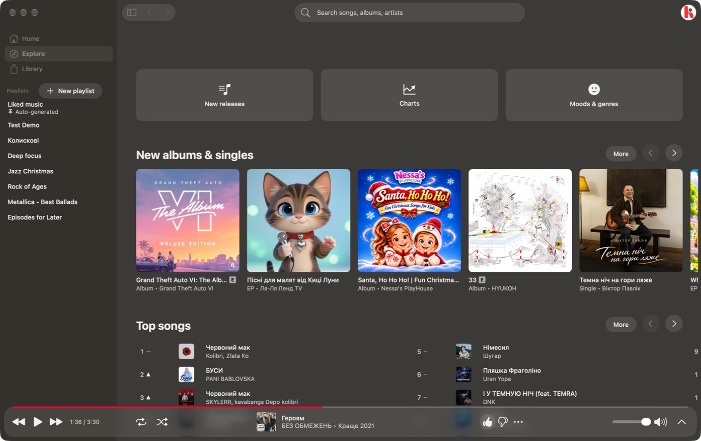
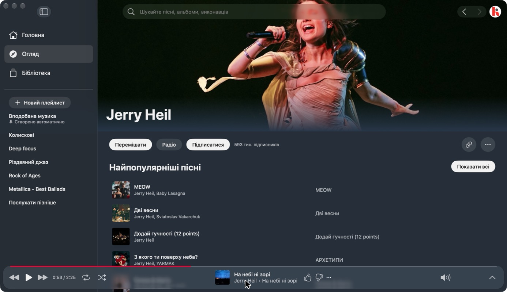
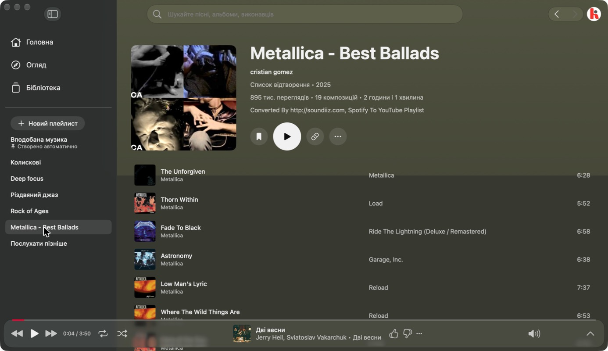
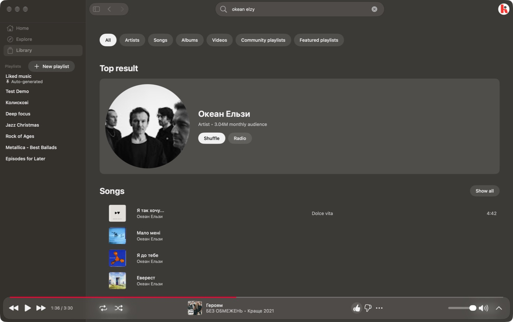
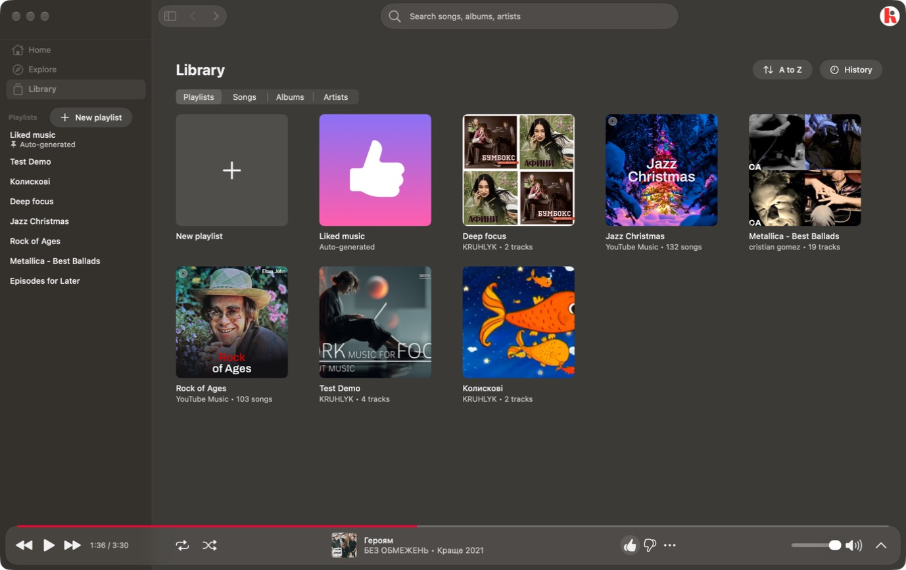
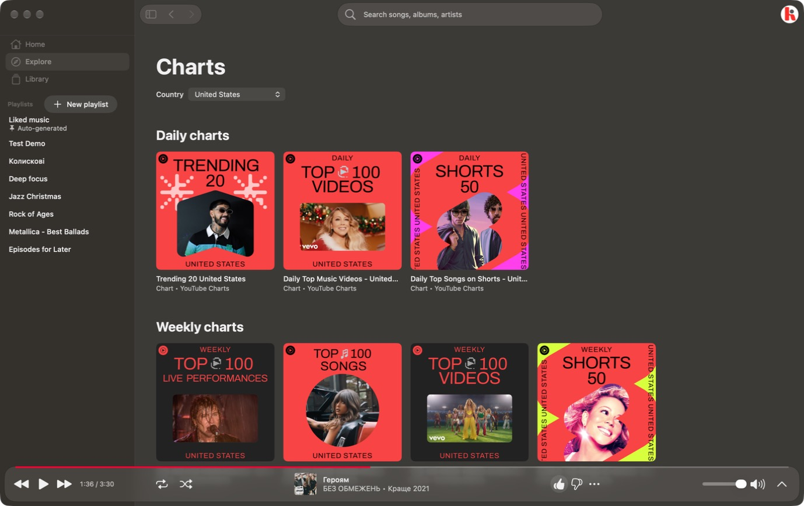
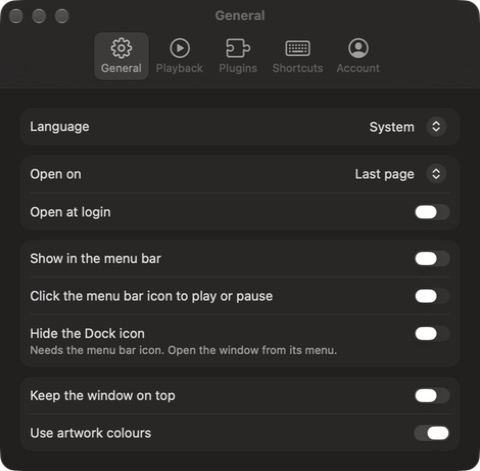

<p align="center">
  
</p>

<p align="center">
  <a href="https://github.com/AratKruglik/ruta-wave/releases"></a>
  
  
  
  <a href="https://github.com/AratKruglik/ruta-wave/actions/workflows/ci.yml"></a>
</p>

<p align="center">
  <b>YouTube Music as a real Mac app: a native SwiftUI interface, media keys, a menu bar player and no Electron.</b>
</p>

<p align="center">
  
</p>

---

## Why RutaWave

YouTube Music has no macOS app. Today you listen to it in a browser tab, a PWA or an Electron wrapper. Each of those runs a whole Chromium for one website. They lose media keys among browser tabs, and they never feel like a Mac app.

RutaWave is a YouTube Music client built for the Mac:

- **Native.** Every screen is SwiftUI: a real sidebar, menus, keyboard focus, VoiceOver and system window behaviour.
- **Light.** There is no bundled browser. Playback runs in one hidden `WKWebView` holding the site's own player, and the app controls it from Swift.
- **Full catalogue.** Your account, library, recommendations and Premium audio quality are all there, because playback goes through the official web player.
- **Works without an account.** Guest mode lets you browse, search and play without signing in.

> The name comes from *Chervona Ruta*, a song every Ukrainian knows. "Ruta" stands for music and for red; "Wave" is sound.

## Features

### 🎧 Listening
- Player bar with artwork, seek, volume, like/dislike, shuffle and repeat
- Full-screen **player page** with the *Up next* queue, lyrics and *Related* tabs
- Queue management: jump, drag to reorder, remove, *Play next*, *Add to queue*, radio filter chips and *Save queue as playlist*
- Audio keeps playing while the window is minimized, hidden or on another Space
- The player recovers on its own from a web view crash and returns to the same track and position

### 🧭 Discovery
- **Home** with mood chips and horizontal shelves
- **Explore**: new releases, **charts** with a country picker, moods & genres
- Artist pages (with *Subscribe* and *Radio*), album and playlist pages, plus *More* lists for every shelf
- **Search** with suggestions as you type, a top result and filters (songs, videos, albums, artists, playlists)

### 📚 Library (signed in)
- Playlists, songs, albums, artists, subscriptions and liked music
- Your playlists in the sidebar, and *New playlist* (⌘N)
- Like, save to library, add to playlist, edit your own playlists
- Listening history, with removal from history

### 🍎 Built for macOS
- **Now Playing** in Control Centre, media keys and AirPods controls
- A full **app menu** with keyboard shortcuts (⌘→ / ⌘← for tracks, ⇧⌘→ / ⇧⌘← to seek, ⌘↑ / ⌘↓ for volume, ⌥⌘L to like, ⌘P for the player page, ⌘F to search)
- **Menu bar item** with the current track; you can set a click on it to play or pause
- **Mini player** (⇧⌘M), *Keep window on top*, *Hide Dock icon*, *Launch at login*, start page choice
- The interface **takes its colours from the artwork** of the current album or playlist
- Opens `music.youtube.com/…` links and `rutawave://` links
- Interface in **English and Ukrainian**

### 🧩 Plugins
- **Notifications** when the track changes
- **Karaoke lyrics**, an experimental mode that highlights each word as it is sung
- More plugins are planned for 0.2

## Screenshots

<table>
  <tr>
    <td width="50%"><p align="center"><sub><b>Player page</b>: artwork, the <i>Up next</i> queue and radio chips</sub></p></td>
    <td width="50%"><p align="center"><sub><b>Explore</b>: new releases, charts, moods &amp; genres</sub></p></td>
  </tr>
  <tr>
    <td><p align="center"><sub><b>Artist</b>: top songs, shuffle, radio, subscribe</sub></p></td>
    <td><p align="center"><sub><b>Playlist</b>: play, shuffle, save and share</sub></p></td>
  </tr>
  <tr>
    <td><p align="center"><sub><b>Search</b>: filters, the top result and songs</sub></p></td>
    <td><p align="center"><sub><b>Library</b>: your playlists, with sorting and history</sub></p></td>
  </tr>
  <tr>
    <td><p align="center"><sub><b>Charts</b>: daily and weekly, for any country</sub></p></td>
    <td align="center"><p align="center"><sub><b>Settings</b>: language, start page, menu bar, Dock, window</sub></p></td>
  </tr>
</table>

## Install

**Requirements:** a Mac with Apple Silicon and macOS 14 or later.

1. Download the latest `RutaWave-<version>.dmg` from [Releases](https://github.com/AratKruglik/ruta-wave/releases).
2. Open it and drag **RutaWave** to **Applications**.

Releases from 0.1.0-beta.6 on are signed with a Developer ID and notarized by Apple, so macOS opens them without extra steps.

The app starts in guest mode. To get your library and Premium, sign in from the account button in the top-right corner. Sign-in happens on Google's own page inside the app, and your password never passes through RutaWave's code. The session is stored in the Keychain. *Sign out* clears it from this Mac.

## Build from source

You need Xcode 27 (macOS 26 SDK) and [XcodeGen](https://github.com/yonaskolb/XcodeGen).

```bash
brew install xcodegen
```

```bash
xcodegen generate
```

```bash
open Rutawave.xcodeproj
```

Then run the **Rutawave** scheme. To build a release DMG into `build/dmg/`:

```bash
Scripts/make-dmg.sh 0.1.0
```

To run the tests the same way CI does:

```bash
for package in Packages/*/; do swift test --package-path "$package"; done
```

```bash
xcodebuild test -project Rutawave.xcodeproj -scheme Rutawave -destination 'platform=macOS'
```

## How it works

```
┌────────────────────────── RutaWave.app (SwiftUI) ──────────────────────────┐
│  Shell · Home · Explore · Search · Library · Player page · Settings        │
│        │                          │                          │              │
│   InnerTube  ◄── cookies ──  Auth (Keychain)           PlayerEngine         │
│   (browse, search, library,                            hidden WKWebView     │
│    likes, queue — JSON API)                            + JS bridge          │
│        │                                                     │              │
│   SystemKit: Now Playing · media keys · notifications · network monitor     │
│   Plugins:   notifications · karaoke lyrics                                 │
└─────────────────────────────────────────────────────────────────────────────┘
```

| Module | Role |
|---|---|
| [`App`](App) | The SwiftUI interface: shell, navigation, screens, player bar, menus |
| [`Packages/InnerTube`](Packages/InnerTube) | Client for the `music.youtube.com` InnerTube API: parsers for shelves, pages, search and lyrics |
| [`Packages/Auth`](Packages/Auth) | Google sign-in in a `WKWebView` and the session in the Keychain |
| [`Packages/PlayerEngine`](Packages/PlayerEngine) | Hidden web player, its command and event bridge, crash recovery |
| [`Packages/SystemKit`](Packages/SystemKit) | Now Playing, remote commands, track notifications, network state |
| [`Packages/Plugins`](Packages/Plugins) | Plugin registry and the built-in plugins |
| [`Packages/AppSettings`](Packages/AppSettings) | User preferences |

The [`docs/`](docs) folder explains the reasoning: [product requirements](docs/00-prd.md), [architecture](docs/02-architecture.md), [roadmap](docs/03-roadmap.md), [design book](docs/07-designbook.md) and [UI spec](docs/08-ui-spec.md). It also covers why audio goes through the site's player and not through direct streams.

## What RutaWave does not do

These are product decisions, not gaps:

- download tracks or cache audio for offline listening;
- block ads or analytics (free accounts and guests hear the ads YouTube serves);
- run on Windows, Linux or iOS, or ship through the App Store.

## Disclaimer

*RutaWave is an independent project and is not affiliated with, endorsed or sponsored by Google or YouTube.* "YouTube" and "YouTube Music" are trademarks of Google LLC and appear here only to describe what the app works with.

<p align="center"><sub>Made in Ukraine 🇺🇦</sub></p>
